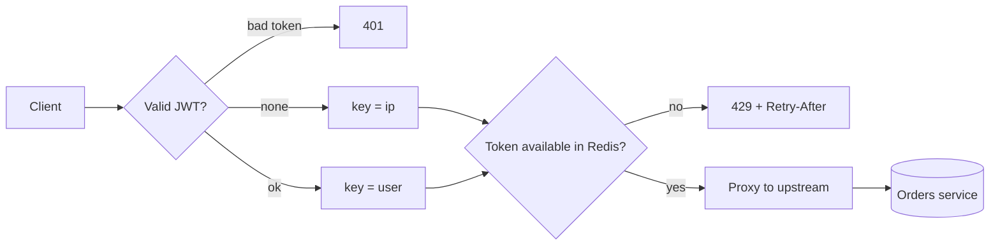

# API Gateway


A small reverse-proxy API gateway built to show how rate limiting really works under concurrency.
It authenticates callers with JWT, limits them with an **atomic token bucket in Redis (Lua)**, and
proxies allowed traffic to an upstream service.

**Stack:** Python, FastAPI, asyncio, Redis, httpx, PyJWT, pytest, Docker Compose, GitHub Actions

## Why this exists

The simple way to rate limit is to read a counter from Redis, check it in Python, then write it back.
Under load, several requests read the same value and all get through. This project fixes that
with a single Lua script that refills, checks and decrements the bucket in one atomic step.

The proof is in the tests and the demo: **200 simultaneous requests from one user, and exactly 10
get through.**

## How a request flows



| Step | What happens | Failure |
|---|---|---|
| Authenticate | Bearer JWT (HS256 only). No token means anonymous. | `401` |
| Rate limit | Token bucket per user (by plan) or per IP | `429` with `Retry-After` |
| Proxy | Longest-prefix match in `routes.yaml`, forwarded with httpx | `404`, `502`, `504` |
| Log | One structured log line per request | n/a |

Every response also carries `X-RateLimit-Limit` and `X-RateLimit-Remaining`.

| Plan | Burst (capacity) | Sustained |
|---|---|---|
| anonymous (per IP) | 5 | 5 per minute |
| free | 10 | 10 per minute |
| pro | 100 | 100 per minute |

## Quick start

You need Docker.

```bash
git clone https://github.com/HemanthAce19/api-gateway.git
cd api-gateway
docker compose up --build
```

In a second terminal:

```bash
bash scripts/demo.sh
```

The demo walks through six scenes: an unprotected service, anonymous limits, a rejected token,
free vs pro plans, the identity headers the upstream receives, and a 200-request concurrent burst.
Expected output for the key moments:

```
2. Same API through the gateway, anonymous (limit: 5 per IP)
200 200 200 200 200 429 429 429

4. Plans: free allows 10 requests per minute, pro allows 100 (12 requests each)
free: 200 200 200 200 200 200 200 200 200 200 429 429
pro:  200 200 200 200 200 200 200 200 200 200 200 200

6. Concurrency: 200 simultaneous requests from one free user
  HTTP 200: 10
  HTTP 429: 190
```

Try it by hand:

```bash
TOKEN=$(curl -s -X POST localhost:8000/auth/demo-token -H 'Content-Type: application/json' \
  -d '{"sub":"alice","plan":"free"}' | python3 -c 'import sys,json; print(json.load(sys.stdin)["access_token"])')

curl -i localhost:8000/orders -H "Authorization: Bearer $TOKEN"
```

Gateway log line for each request:

```
INFO request user=bob plan=free method=GET path=/orders status=429 latency_ms=75.6
```

## Run without Docker

```bash
python -m venv .venv && source .venv/bin/activate
pip install -e ".[dev]"
docker run -d -p 6379:6379 redis:7-alpine        # or: brew install redis && redis-server

export JWT_SECRET="a-long-random-string-of-at-least-32-characters"
export DEMO_MODE=true
uvicorn demo_service.main:app --port 9000 &
uvicorn gateway.main:create_app --factory --port 8000
```

## Tests

```bash
pytest -v                                         # uses an in-memory Redis with Lua support
REDIS_URL=redis://localhost:6379/0 pytest -v      # same tests against a real Redis (CI does this)
```

47 tests cover:

- **JWT:** expiry, wrong signature, `alg: none` forgery, algorithm pinning, missing or unknown plan
- **Limiter:** capacity, refill over time, independent keys, retry-after, TTL
- **Concurrency:** 200 parallel calls admit exactly `capacity`, including from two limiter instances sharing one Redis
- **Gateway:** plan limits, identity header spoofing, token stripping, 401/404/429/502/504, Redis outage in both fail modes

I also checked that the tests can fail: breaking the Lua script makes 11 tests fail, and weakening
the JWT algorithm list makes 2 fail.

## Configuration

| Variable | Default | Meaning |
|---|---|---|
| `JWT_SECRET` | none, required | HS256 secret, at least 32 characters or the app will not start |
| `REDIS_URL` | `redis://localhost:6379/0` | Redis connection |
| `ROUTES_FILE` | `routes.yaml` | Path prefix to upstream map |
| `DEMO_UPSTREAM` | `http://localhost:9000` | Substituted into `routes.yaml` |
| `DEMO_MODE` | `false` | Enables `POST /auth/demo-token`. Never enable in production |
| `RATE_LIMIT_FAIL_MODE` | `open` | If Redis is down: `open` allows traffic, `closed` returns 503 |
| `UPSTREAM_TIMEOUT` | `5` | Seconds before a `504` |
| `RL_<PLAN>_CAPACITY`, `RL_<PLAN>_PER_MINUTE` | see table above | Per-plan limits (`ANONYMOUS`, `FREE`, `PRO`) |

## Design decisions

- **Lua over GET/SET.** Atomicity is the whole point. See [ADR-001](.10x/adrs/001-atomic-token-bucket-in-redis-lua.md).
- **Redis as the only clock.** The script uses Redis `TIME`, so gateway instances with drifting clocks agree.
- **Continuous refill, not fixed windows.** No burst at the window boundary.
- **Auth before rate limit.** Invalid tokens are rejected without touching Redis.
- **Pinned JWT algorithm.** Only HS256 is accepted, which blocks `alg: none` and algorithm confusion.
- **Fail open by default.** A Redis outage should not take the API down. Switch to `closed` if abuse is the bigger risk.
- **Callers cannot claim an identity.** Incoming `X-User-Id` and `X-User-Plan` are discarded and replaced from the verified token.

## Known limitations

- `X-Forwarded-For` is ignored for anonymous limits because it is trivially spoofable. Behind a load balancer all anonymous callers would share one IP bucket; a trusted-proxy setting would be the fix.
- HS256 means the gateway and token issuer share a secret. A real deployment would use RS256 with a JWKS endpoint.
- Responses are buffered, not streamed. Fine for JSON APIs, not for large downloads.
- One Redis instance. Redis Cluster would work with this script because it touches a single key.
- The demo orders service stores data in memory.

## Project layout

```
gateway/        app factory, JWT auth, Lua token bucket, route table, proxy, settings
demo_service/   the unprotected orders API used in the demo
scripts/        demo.sh (guided demo), load_test.py, make_token.py
tests/          pytest suite
docs/DEMO.md    how to present this project
.10x/           design spec, ADR and the build decision log
```
